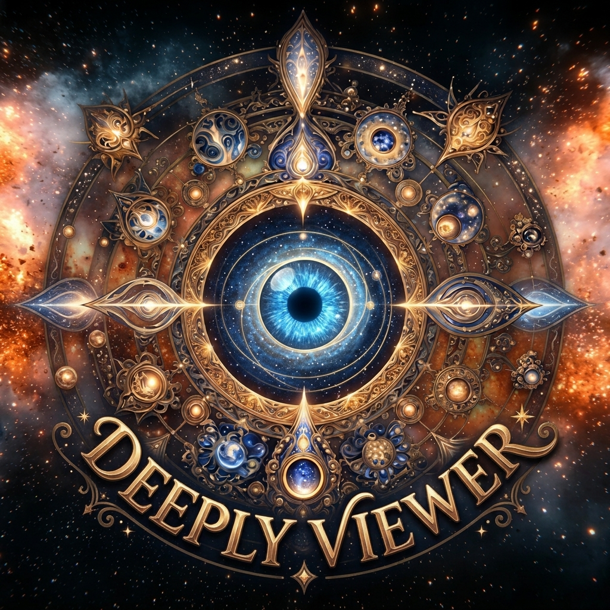

  

<h1 align="center">Deeply Viewer</h1>

  <strong>0.9.11 Stable</strong> 
  Independent community viewer for Second Life and compatible grids

  <a href="https://github.com/Diablo85666/Deeply-Viewer/releases/latest">Download</a> ·
  <a href="https://github.com/Diablo85666/Deeply-Viewer/releases">Releases</a> ·
  <a href="https://github.com/Diablo85666/Deeply-Viewer/issues">Issues</a> ·
  <a href="https://github.com/Diablo85666">Author profile</a>

Deeply Viewer is an independent community fork derived from Deeply Viewer
and Firestorm. It is not affiliated with or endorsed by Linden Lab or any
other viewer project.

## Novità

La release 0.9.11 include:

- branding Deeply Viewer nell'eseguibile, login, splash, icona e notifiche;
- logo, splash e icona Windows nella cartella
  [`assets/deeply/`](assets/deeply/);
- interfaccia italiana e localizzazioni inglese, francese e giapponese;
- browser integrato con supporto HTTP, HTTPS, SLURL e app link compatibili;
- controlli per avatar, teleport, voce e conference chat;
- grafica adattiva con recupero delle texture e profili Custom protetti;
- importazione e condivisione locale opzionale dei transcript compatibili;
- report locali, copia negli appunti e bozze GitHub senza invio automatico;
- traduzione offline NLLB model manuale dai messaggi, attivata solo dopo il clic;
- pacchetto portable verificabile con SHA-256.

## Download Windows

Scarica il pacchetto dalla [release Deeply Viewer
0.9.11](https://github.com/Diablo85666/Deeply-Viewer/releases/tag/v0.9.11).

File principale:

`Deeply-Viewer-v0.9.11-windows-x64.zip`

Il pacchetto contiene `deeply-viewer.exe`, gli asset Deeply, le licenze e la
documentazione necessaria. Estrarlo in una cartella dedicata e avviare
`deeply-viewer.exe`.

Prima dell'avvio, confronta il checksum del file con
[`Deeply-Viewer-v0.9.11-windows-x64.zip.sha256`](https://github.com/Diablo85666/Deeply-Viewer/releases/download/v0.9.11/Deeply-Viewer-v0.9.11-windows-x64.zip.sha256).
Puoi verificare anche la firma
[`Deeply-Viewer-v0.9.11-windows-x64.zip.minisig`](https://github.com/Diablo85666/Deeply-Viewer/releases/download/v0.9.11/Deeply-Viewer-v0.9.11-windows-x64.zip.minisig)
con la chiave pubblica Minisign distribuita dal maintainer. Il checksum e la
firma confermano integrità e provenienza della build, ma non sostituiscono una
scansione antivirus.

## English

Deeply Viewer 0.9.11 includes:

- Deeply Viewer branding in the executable, login screen, splash, icon and
  notifications;
- the Deeply logo, splash and Windows icon in
  [`assets/deeply/`](assets/deeply/);
- Italian, English, French and Japanese localization;
- an integrated browser with HTTP, HTTPS, SLURL and compatible app-link
  support;
- avatar, teleport, voice and conference-chat controls;
- adaptive graphics with texture recovery and protected Custom profiles;
- optional local transcript import and sharing;
- local reports, clipboard copy and GitHub drafts without automatic
  submission;
- manual offline NLLB model support started only after the user clicks Translate;
- a portable package with a published SHA-256 checksum.

Download the Windows package from the [Deeply Viewer 0.9.11
release](https://github.com/Diablo85666/Deeply-Viewer/releases/tag/v0.9.11).
Extract `Deeply-Viewer-v0.9.11-windows-x64.zip` and start
`deeply-viewer.exe`. The release also includes a SHA-256 checksum and a
Minisign signature for the ZIP.

## Documentazione

- [Note di rilascio italiane](Deeply-Viewer-0.9.11-Release-Notes-it.txt)
- [Release notes in English](Deeply-Viewer-0.9.11-Release-Notes-en.txt)
- [Guida italiana](Deeply-Viewer-0.9.11-Guida-uso-it.txt)
- [English user guide](Deeply-Viewer-0.9.11-User-Guide-en.txt)
- [Licenza GPLv3](LICENSE)
- [Attribuzioni e responsabilità](NOTICE.md)

## Licenza e attribuzioni

Deeply Viewer is distributed under the GNU GPLv3 terms applicable to the
source code. The upstream attribution and the statement that this is an
independent community fork are retained in [`NOTICE.md`](NOTICE.md).

## Community

- [Repository](https://github.com/Diablo85666/Deeply-Viewer)
- [Releases](https://github.com/Diablo85666/Deeply-Viewer/releases)
- [Issues](https://github.com/Diablo85666/Deeply-Viewer/issues)
- [Author](https://github.com/Diablo85666)
